# Lab 1 - Infrastructure Setup

## 1. Set up account
Register in a cloud provider. Now you have a root account. (1 point)

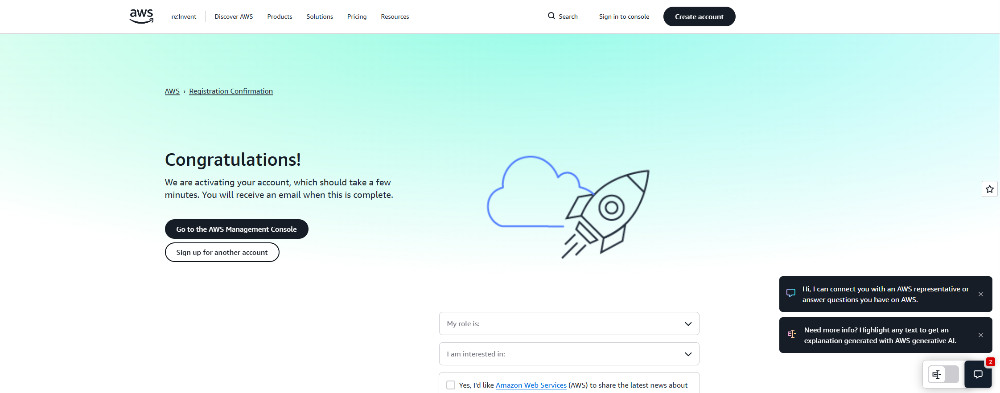

### b) Create an IAM Identity Center account  
Also make it full admin. (2 points)

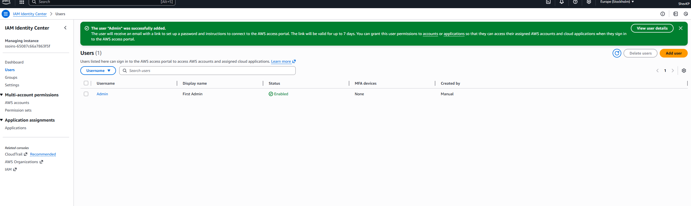

---

## 2. (Optional) Create an Organization  
https://docs.aws.amazon.com/organizations/latest/userguide/orgs_tutorials_basic.html  
All next labs are to be performed within it. (2 points)

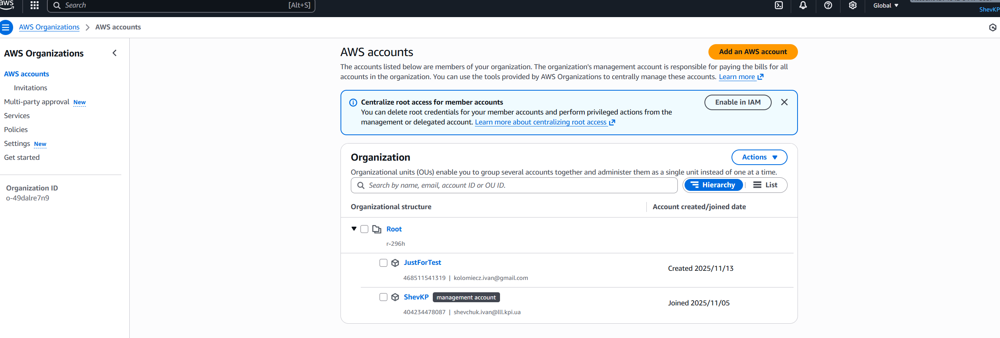

---

## 3. Create one more user  
Create an IAM policy that allows ONLY to view resources (no write access). (1 point)

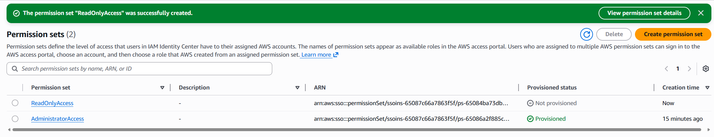
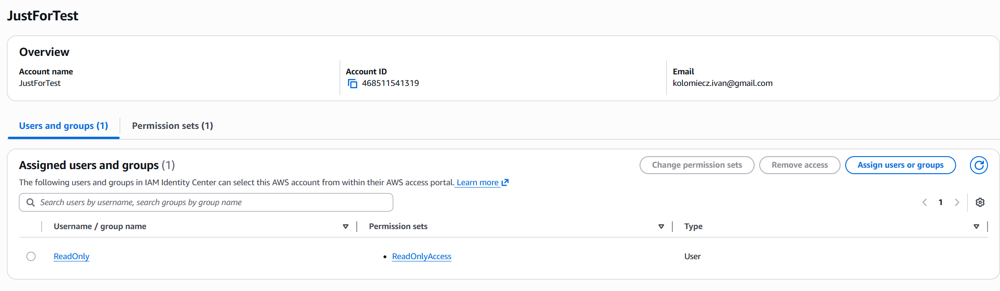

---

## 4. Create a Role  
Attach the read-only policy and allow it to be assumed by user from step 3. (1 point)

Створимо нову роль:
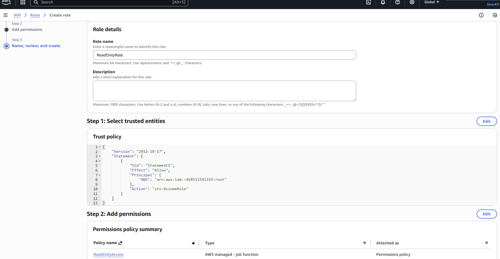

Далі створимо permission set, який дозволяє лише одному юзеру AssumeRole:
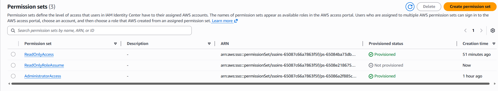
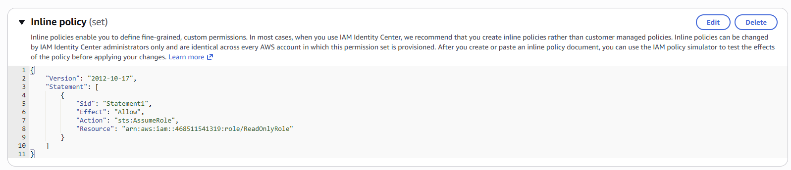

Перевіримо, для цього зайдемо в аккаунт ReadOnly:
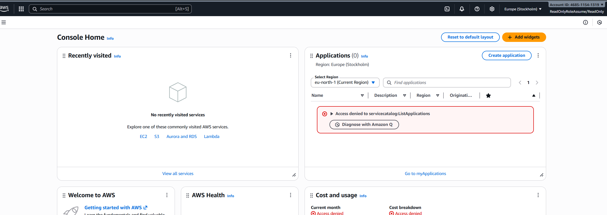

І змінимо роль:
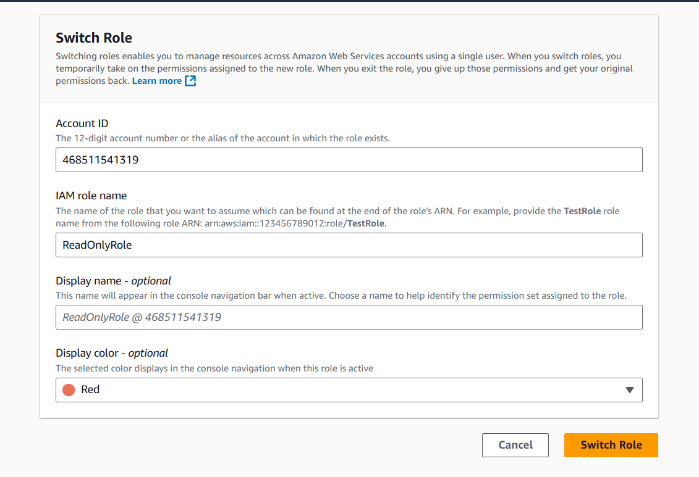

Як можна побачити роль успішно змінено:
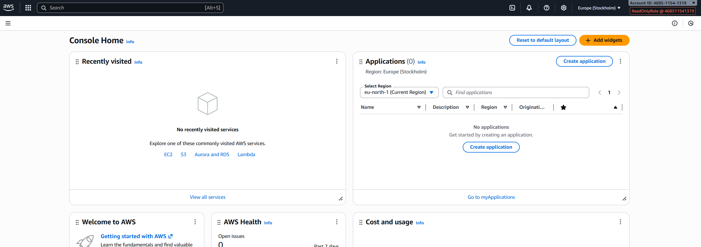

---

## 5. (Optional) IaC template  
Create a CloudFormation / Terraform template describing your policy and role. (1 point)

Створимо CloudFormation-шаблон, який описує IAM роль ReadOnlyRole(Cloud Formation варіант).
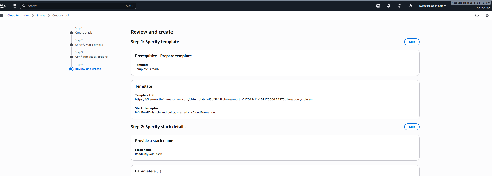

І після запуску отримаємо:
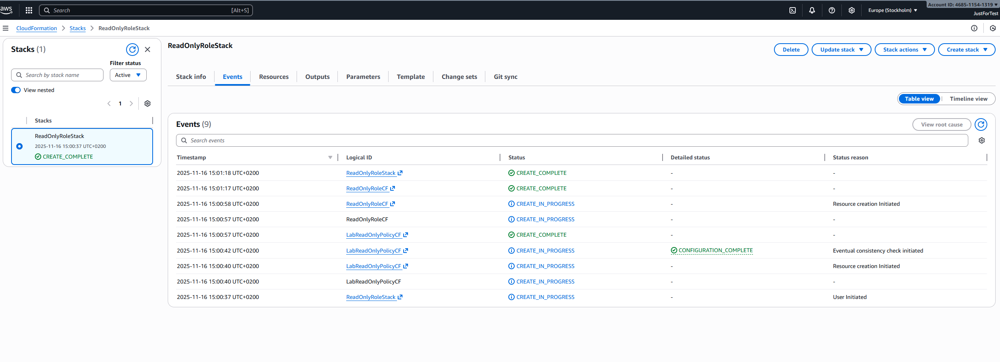

---

## 6. Create a network (VPC)  
The VPC must include:
- Public subnet with Internet Gateway (IGW)  
- Private subnet(s) accessible only internally  
(3 points)

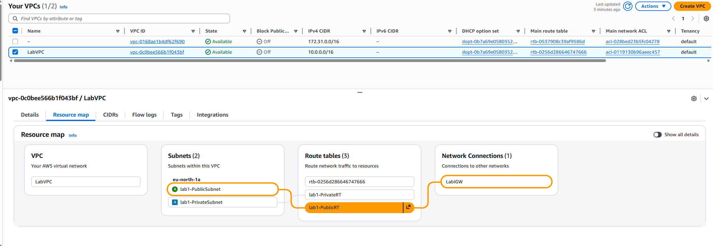

---

## 7. (Optional) Create IaC stack holding your network resources. (2 points)
Реалізуємо через IaC generator, для цього оберемо області скану:
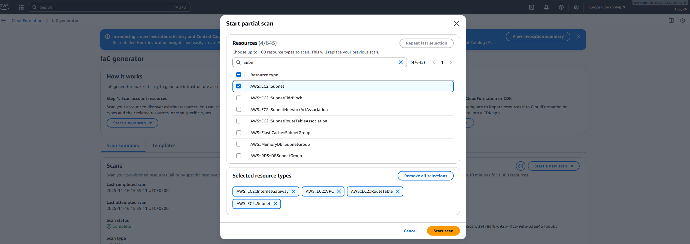

З скану обираємо лише потрібні ресурси:

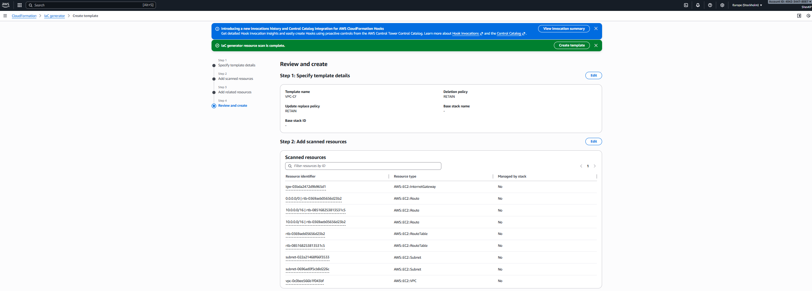

І отримуємо готовий шаблон:

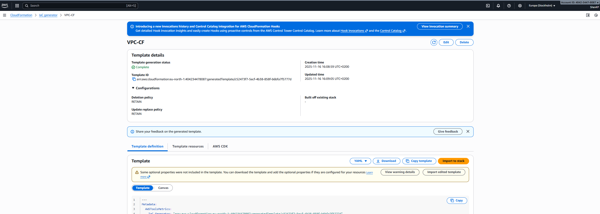

---

## 8. Calculate monthly budget for Lab 2  
Assume 2 shards. (2 points)

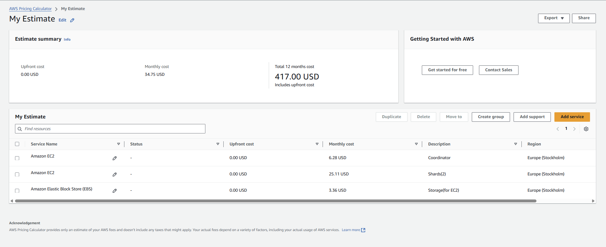
У розрахунок увійшли:
- 1 EC2-інстанс для Coordinator (t4g.micro)
- 2 EC2-інстанси для Shards (t4g.small)
- 3 EBS-томи для зберігання даних (по 8 GB gp3 на кожен інстанс)

У результаті підбір найбільш економних і достатніх за потужністю інстансів дав такі витрати:
- Щомісячна вартість EC2 для Coordinator: 6.28 USD
- Щомісячна вартість EC2 для двох Shards: 25.11 USD
- Щомісячна вартість EBS сховища: 3.36 USD
- Сумарна місячна вартість інфраструктури складає: 34.75 USD

